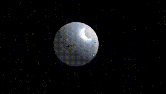
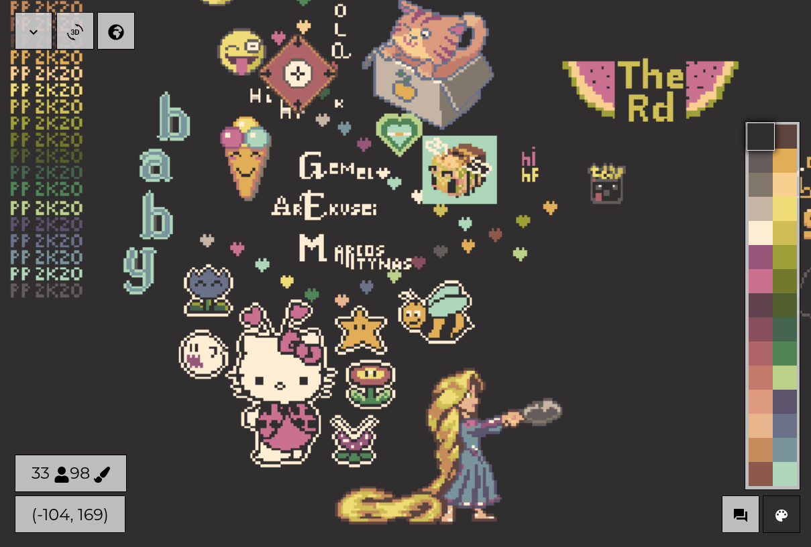
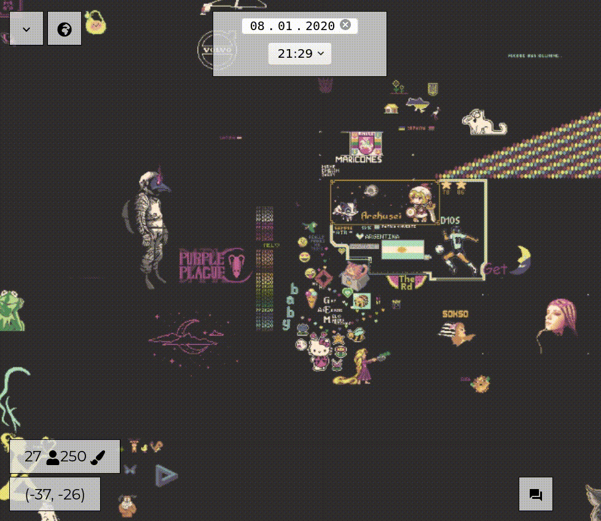
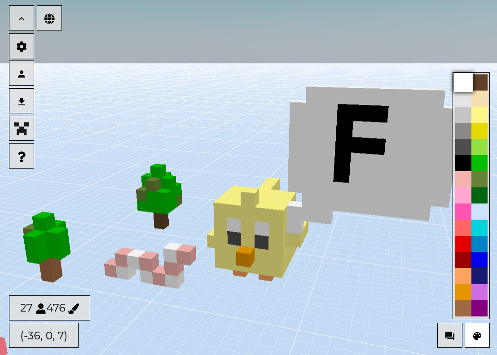

# PixelStates


[](https://pixelplanet.fun/guilded)



> This checkout currently includes English only.

The future rich, 🩸 bleeding edge, 🕹️ paradigm-changing, 💡 easy to use, blazingly 🔥 fast 🚀🚀🚀 corporative pixel placing game 🔥 in your browser 🌐, built in 100% memory safe nodejs 🦀!
A game changer in the world of browser games ✊🏿

### Controls 🎮

- 🅆, 🄰, 🅂, 🄳, click and drag or pan: Move
- 🅀, 🄴 or scroll or pinch: Zoom
- Click 🖱️ or tap 👆: Place Pixel



## Install and Run

### Requirements 📡

- [nodejs environment](https://nodejs.org/en/) (>=21)
- [redis](https://redis.io/) or [redis-for-windows](https://github.com/redis-windows/redis-windows) in version **6.2.0 or above** as database for storìng the canvas
- [mariadb](https://www.mariadbtutorial.com/getting-started/install-mariadb/)
- `ffmpeg` and `perl-Image-ExifTool` (optional, used for media uploads)
- Python 3.10+ and IPQS database files (optional, for local IPQS reputation checks)

Make sure to set up a SQL user and database for PixelStates. The default database and user names remain `pixelplanet` for compatibility; in `mariadb`, run as `root`:

```
CREATE DATABASE pixelplanet;
CREATE USER 'pixelplanet'@'%' IDENTIFIED BY 'sqlpassword';
GRANT ALL PRIVILEGES ON pixelplanet.* TO 'pixelplanet'@'%';
```

### Download 📥

This PixelStates checkout is based on [PixelPlanet](https://git.pixelplanet.fun/ppfun/pixelplanet/releases). If you are installing from an upstream release, download the **pixelplanet-x.x.x.zip** (not the Source Code) and unpack it.

### Configuration 🔧

Configuration takes place in a `.env` file beside the server, or environment
variables. Environment variables take precedence over `.env`; `config.ini` is
supported as a fallback. When building the server, `.env` is copied into
`dist`, so its settings are preserved across builds. Copy `.env.example` to
`.env` and adjust the values for your local services.

Those are options you will most likely want to adjust:

| Variable         | Description                |  Example                |
|------------------|:---------------------------|------------------------:|
| PORT             | Own Port                   | 5000                    |
| HOST             | Own Host                   | "localhost"             |
| REDIS_URL        | URL:PORT of redis server   | "redis://localhost:6379"|
| MARIADB_HOST     | MariaDB Host               | "localhost"             |
| MARIADB_USER     | MariaDB User               | "pixelplanet"           |
| MARIADB_PW       | MariaDB Password           | "sqlpassword"           |
| MARIADB_DATABASE | MariaDB Database           | "pixelplanet"           |
| MAX_WS_CONNECTIONS | Maximum concurrent game WebSockets per process | 5000 |
| MAX_WS_CONNECTIONS_PER_IP | Maximum game WebSockets per IP | 50 |
| USE_IPQS_DB      | Use IPQS offline DB instead of ProxyCheck | no |
| IPQS_READER_PATH | Parent folder containing `IPQualityScore` | unset |
| IPQS_DB_IPV4_PATH| IPQS IPv4 `.ipqs` database file | unset |
| IPQS_DB_IPV6_PATH| IPQS IPv6 `.ipqs` database file (optional) | unset |
| IPQS_PYTHON      | Python executable           | "python"                |
| IPQS_DB_CACHE_MS | Cache duration in milliseconds | 900000 |
| CAPTCHA_PROVIDER | Active CAPTCHA: `turnstile` or `ppfun` | turnstile |
| TURNSTILE_SITE_KEY | Cloudflare public site key; provide at client build time | required for Turnstile |
| TURNSTILE_SECRET_KEY | Cloudflare Turnstile secret key | required for Turnstile |
| TURNSTILE_HOSTNAME | Expected hostname (optional; defaults to request host) | unset |
| TURNSTILE_ACTION | Expected Turnstile action | pixelplanet-captcha |

Create a Cloudflare Turnstile widget for the game's hostname and set its site
key and secret in `.env` or the server environment. The secret is only used by
the server and must never be exposed to the browser. The server verifies each
single-use token through Cloudflare Siteverify before marking the request IP
as verified.

The WebSocket limits count both connected clients and in-progress
authentication, and are applied before session and IP reputation checks.
Online counts are logged when the global limit is reached. These application
limits help contain connection floods but cannot stop volumetric attacks that
saturate the network link; use a CDN/WAF such as Cloudflare for edge
protection.

The Turnstile site key is public by design. Provide it in the build environment
or root `.env`/`config.ini` when building the client. The bundle stores it as
an XOR-encoded value to avoid a plain-text key in the bundle and public config
response; this is obfuscation, not secrecy. The widget must send the key to
Cloudflare, so it remains visible at runtime. Restrict the key to your site
hostnames in Cloudflare, and rebuild the client whenever the site key changes.

Set `CAPTCHA_PROVIDER=ppfun` to use the bundled PPFUN image CAPTCHA and browser
challenge instead. Restart the server after changing the provider. Production
builds minify the browser bundles and do not publish source archives; browser
code must still be delivered to clients to run the site.

When `USE_IPQS_DB=yes`, configure the reader package and at least one database
file. IPQS is read locally by a persistent Python process; it takes precedence
over `USE_PROXYCHECK` and does not call the ProxyCheck service. The IPQS files
are licensed/downloaded separately and are not included with this project.
The Modtools IID tab's `checkproxy` action accepts an IID or numeric user ID
and shows the risk/fraud score, provider confidence when available, connection
type, reputation signals, cache expiry, and full record. A fraud score is a
risk score, not a calibrated probability that an IP is a proxy. Existing IP
whitelists are shown in the results and can be added or removed per IP; a
whitelisted IP is exempt from the game's proxy flag. An IP is blocked as a
proxy only when its risk score is between 95 and 100 inclusive; lower scores
and provider lookup failures do not block pixel placement.

Do not enable IPQS with a sample/test `.ipqs` file. It will not represent the
full address space and can return false negatives. Set `IPQS_DB_IPV4_PATH`
and/or `IPQS_DB_IPV6_PATH` to the complete database files before setting
`USE_IPQS_DB=yes`.

Run `npm start` from the repository root to start the already-built server in
`dist`. Build it first with `npm run build:dev` if needed.

For a complete local startup, run:

```
npm run start:local
```

This builds the server and English client (including Modtools), restores the
world land mask from `utils/ocean-tiles/ocean`, regenerates cached tiles for
all 2D canvases, and then starts the server. Redis and MariaDB must already be
running. The server creates or migrates its SQL tables at startup. Configure
Turnstile keys when `CAPTCHA_PROVIDER=turnstile`. The land restore preserves
non-empty pixels; tile regeneration only rewrites generated cache files and
can take several minutes.

Use `npm run start:local -- --skip-world-repair` for a quicker start that
keeps the current Redis canvas and tile cache, or `--skip-build` to reuse
existing build output. `--dry-run` prints the steps without changing data.

#### Canvas Configuration

Canvas specific configuartion like colors and cooldown is in `canvases.json` for all canvases.
Meaning of some values:

##### Neccessary configuration per canvas

| Key    | Description                                                     |
|--------|:----------------------------------------------------------------|
| ident  | Unique character used in the url                                |
| size   | canvas size, power of 2 and between 256 and 65536               |
| bcd    | Base cooldown for unset pixels                                  |
| cds    | Stack time of Cooldown                                          |

##### Optional configuration per canvas

| Key    | Description                                                     |
|--------|:----------------------------------------------------------------|
| title  | Title of the canvas                                             |
| desc   | Description of the canvas                                       |
| pcd    | Cooldown for placing on set pixels (defaults to same as bcd)    |
| cli    | Number of leading colors on the palette to ignore (default: 0)  |
| req    | requieremt to place on the canvas (default: unset)              |
| ranked | If pixels on canvas count on player statistic (default: false)  |
| v      | If 3D voxel canvas (boolean) (default: false)                   |
| hid    | Hidden canvases, can be just seen by pressing P (default: false)|
| sd     | Start-date of the canvas (for historical view)                  |
| ed     | end date for historical view (canvas retired)                   |
| dcc    | Array of country codes that default to this canvas              |
| linkcd | id of another canvas to take the cooldown from                  |

Notes:

- If `req` is 0, the canvas is only available for registered useers. If it is a number >1 it is the amount of total pixels placed before a player is allowed to play there. If it is `top`, then it is only accessible for the Top10 players of the previous day.
- The colors that are ignored via `cli` are used for making the canvas (blue ocean and white continents) and to know if the pixel is already set by a user or not.
- If you want to add a new canvas, be sure that you additionally create `public/loading${canvasId}.png`, `public/assets3d/normal${canvasId}.jpg`, `public/preview${canvasId}.png` and `public/assets3d/specular${canvasId}.jpg`, check out the existing ones to see what those files are for.

### Preperation 📊

Inside the project folder, install the required packages:

```
npm install
```

### Running ‍⚡

1. Make sure that mariadb and redis are running
3. Start with

```
npm start
```

Now you can access PixelStates on `http://localhost:5000` or whatever other *HOST* and *PORT* you chose inside `config.ini`.

### Stopping 🛑

Press Ctrl-C

### What to do next❓

Read [DEPLOYMENT.md](./doc/DEPLOYMENT.md) for tips on how to run it on a server.

## Build from Source

### Requirements 📡
- [nodejs environment](https://nodejs.org/en/) (>=20)

### Building 🤖
Checkout repository

```
git clone https://git.gs-os.com/ppfun/pixelplanet.git
cd pixelplanet
```

Install packages and build

```
npm install
npm run build
```

To build the production server and English client only, run `npm run build:En`.

All needed files to run it got created in `./dist`. You can copy it to wherever you want to run pixelplanet.

## Development

Run `npm run lint:src` to check for code errors and warnings or `npm run lint -- ./your/file.js` to check a single file.

Compile with source-maps and debug options (but only english language) with

```
npm run build:dev
```

[ttag](https://github.com/ttag-org/ttag/) is used for handling translations. For server-side rendering the `Accept-Language` header gets checked and the first locale used and on-the-fly translated (`src/core/ttag.js` provides the functions). On the client-side a seperate bundle for every language gets provided.
The language definitions in `i18n/template.pot` and `i18n/template-ssr.pot` get updated when doing a production build (`npm run build`). This checkout currently builds English only.

To build additional languages, add their translation files to `i18n` and define them with the `--langs` flag (probably won't work on Windows):

```
npm run build -- --langs de,gr
```

### Customization 👑

For customization check out [CUSTOMIZATION.md](./doc/CUSTOMIZATION.md).

## Hourly Event

Hourly event is an MMORPG style event that launches once in two hours where users have to fight against a growing void that starts at a random position at the main canvas. If they complete it successfully, the whole canvas will have half cooldown for a few minutes.

## Backups and Historical View

PixelStates includes a backup script that creates full canvas backups daily in the form of PNG tile files and incremental backups every 15 to 20 minutes.

It requires a [second running redis instance](https://www.digitalocean.com/community/questions/multiple-redis-instances-on-ubuntu-16-04).

See the `config.ini` section about Historical View to learn more.

- You do not have to run backups or historical view, it's optional.



## 3D canvas

If v is set and true for a canvas in the canvas.json, it will be a 3D voxel canvas.
3D Canvases can not be seen in Historical View.


